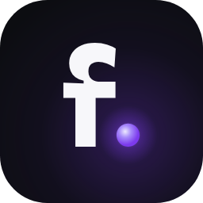
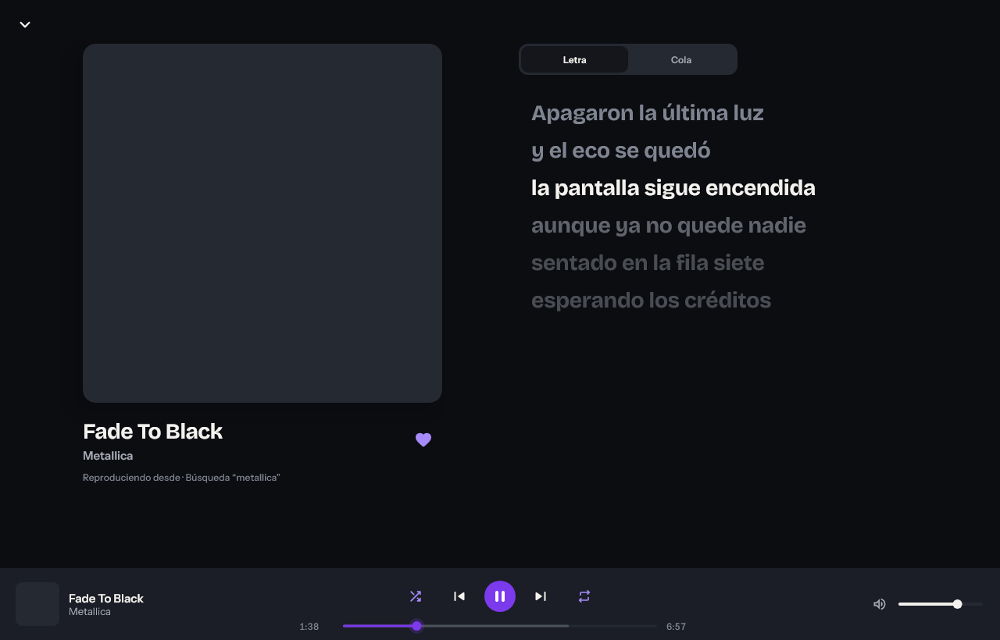
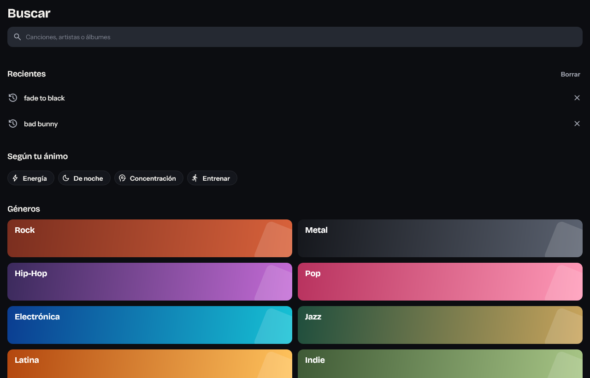
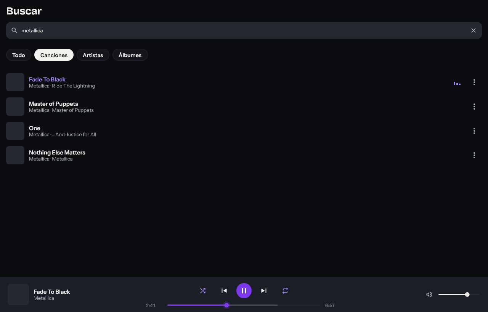
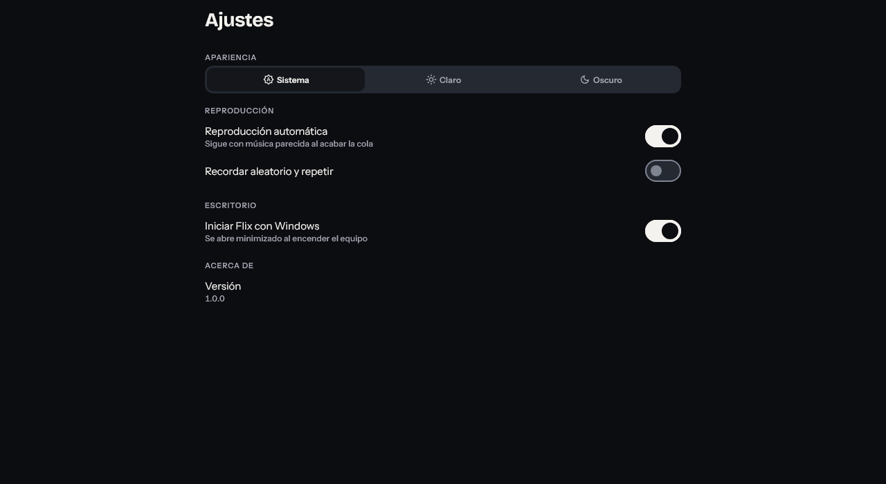
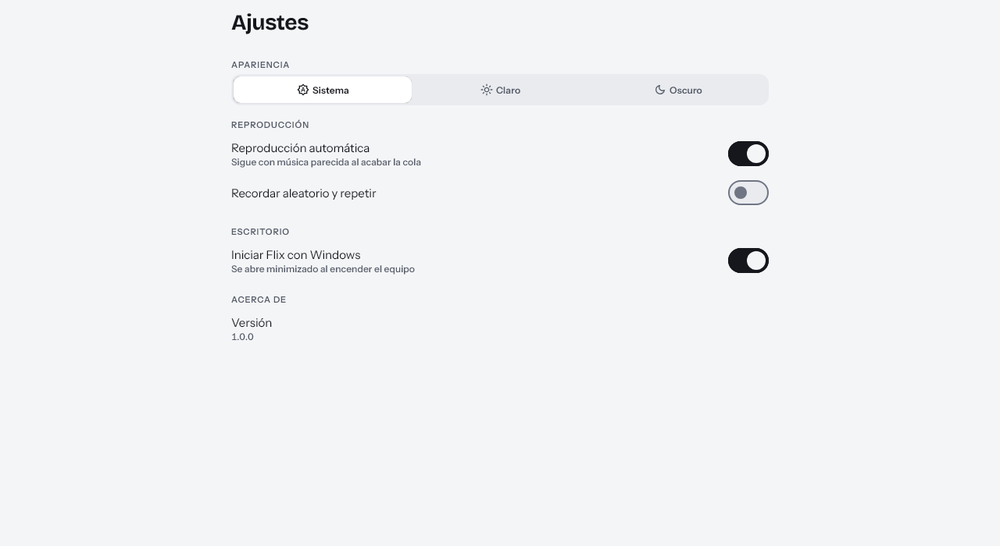

<p align="center">
  
</p>

<h1 align="center">Flix Desktop</h1>

<p align="center">
  Reproductor de música para Windows, hecho con Kotlin y Compose Multiplatform.<br>
  Busca, escucha, guarda tus favoritos y descarga canciones, sin cuenta y sin anuncios.
</p>

<p align="center">
  
</p>

## Características

- **Búsqueda** de canciones, artistas y álbumes en YouTube Music.
- **Reproducción automática**: al tocar una canción, Flix sigue con música parecida (la "radio" de la canción) sin repetir versiones de la misma.
- **Aleatorio y repetir** (todo / una), con opción de recordarlos al reiniciar.
- **Letra sincronizada** (LRCLIB) y **cola** editable: reordenar, quitar, deshacer.
- **Biblioteca**: favoritos, listas de reproducción, historial, álbumes y artistas guardados, estadísticas de escucha.
- **Descargas** para escuchar sin conexión.
- **Integración con Windows**: teclas multimedia, bandeja del sistema, instancia única, iniciar con Windows y recuerda por dónde ibas.
- Tema claro, oscuro o del sistema.

## Capturas

| Búsqueda | Resultados |
|---|---|
|  |  |

| Ajustes (oscuro) | Ajustes (claro) |
|---|---|
|  |  |

## Instalación

Descarga el instalador `Flix-1.0.0.msi` desde la sección de [Releases](../../releases) y ejecútalo. Incluye todo lo necesario (también el runtime de Java).

## Compilar desde el código

Requisitos: Windows 10/11, JDK 17+ y [7-Zip](https://www.7-zip.org/).

```powershell
# 1. Descarga libmpv (el motor de audio, no se versiona por su tamaño)
powershell -File scripts/fetch-libmpv.ps1

# 2. Ejecutar
./gradlew.bat :app:run

# 3. Tests
./gradlew.bat :app:test

# 4. Generar el instalador MSI
./gradlew.bat :app:packageMsi
```

## Tecnologías

Kotlin · Compose Multiplatform Desktop · Room · DataStore · OkHttp · NewPipeExtractor · libmpv (JNA) · Coroutines

## Estructura

```
app/src/main/kotlin/com/flix/music/
├── core/      # reproductor, datos (YouTube Music, letras, Room), sistema y diseño
├── feature/   # pantallas: inicio, búsqueda, biblioteca, reproductor, ajustes…
└── navigation/
```

## Aviso

Flix es un proyecto personal con fines educativos. No almacena ni distribuye música; el contenido proviene de servicios de terceros y su uso es responsabilidad de quien lo utiliza.

## Licencia

[GPL-3.0](LICENSE)
